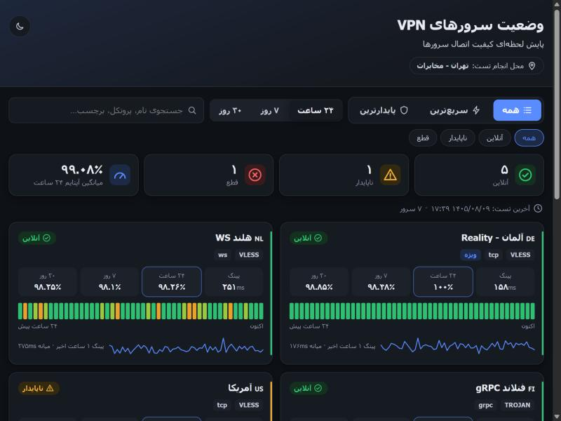
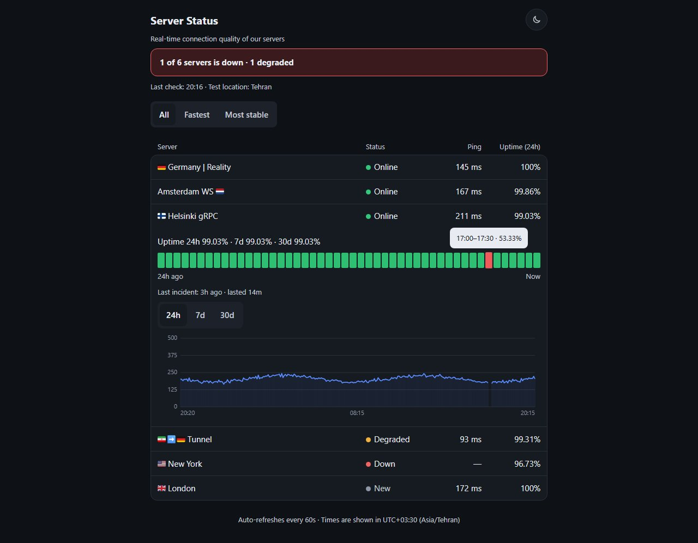
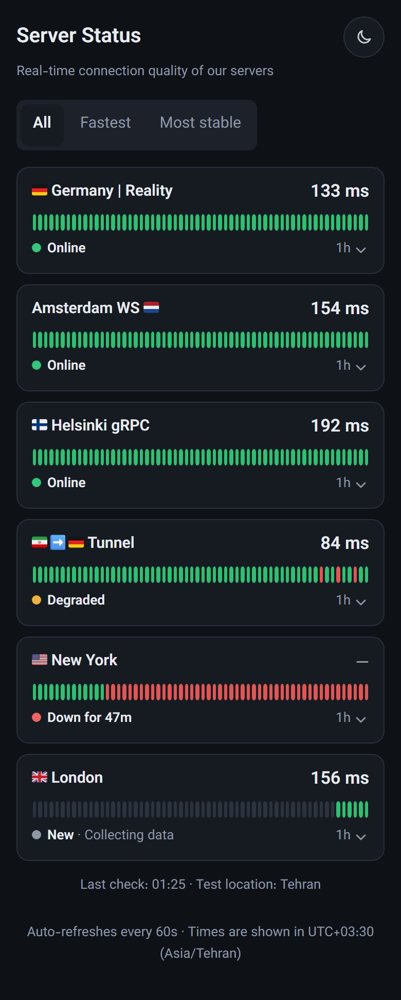
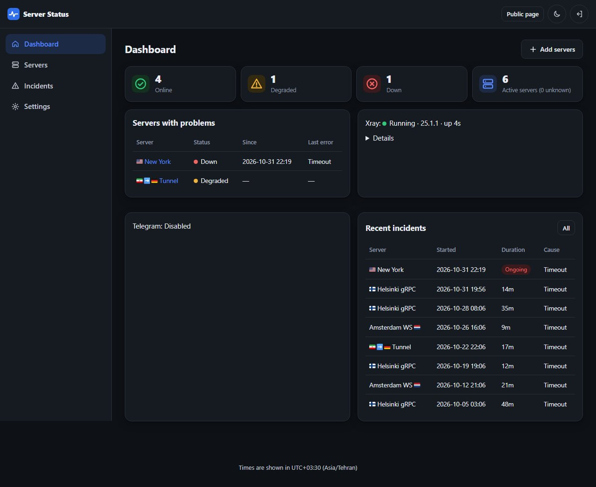
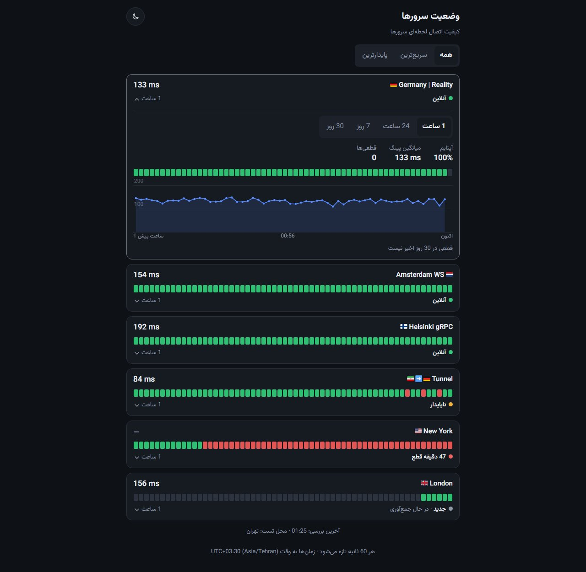

# v2uptime

v2uptime checks V2Ray share links by connecting through Xray, on a timer (60 seconds by default), and publishes the result on a public status page and in a Telegram bot. Times in the interface are Gregorian, 24-hour, with Latin digits. The database stores UTC Unix epochs.

## Overview

One Xray process serves every server. Each server gets a local SOCKS inbound. A check sends two requests to the configured test URL over one keep-alive connection through that inbound. The first (cold) request opens the connection: the tunnel to the server (including TLS or REALITY) and the connection to the test host. It decides the result; a 2xx response is a success. Its time is stored as the **connect time**. The second (warm) request runs on the connection that is already open. Its time is the **Ping**: the round trip of one request through the server, the same idea as the delay in 3x-ui. It is not an ICMP ping.

The public page lists each server’s status, ping, and uptime. The admin panel adds servers, incidents, Telegram, and settings. Share links, addresses, and ports are not shown on the public page, in the public API, or in Telegram messages.

## Features

- Protocols: `vless`, `vmess`, `trojan`, `ss`. Transports: `tcp` (optional HTTP header), `ws`, `grpc`, `httpupgrade`, `xhttp`, `kcp`. Security: `none`, `tls`, `reality`.
- Add one link, many links (one per line), a subscription URL (fetched once; nothing is synced later), or pasted subscription content.
- Add, edit, and remove servers through the Xray API while the process stays up. If a hot reload fails, Xray restarts once and the check cycle that overlapped the restart is discarded.
- Detects when the monitor’s own internet is down (a direct reference request) and keeps those results out of uptime.
- Incidents use an N/M rule. Flapping is detected. Incident stats include count, downtime, mean time to recover, and longest outage.
- Public page: one card per server with its name and ping, the last 60 checks, and its status. Fastest and Most stable sorting. An open card starts on 1h, and the same control also has 24h, 7d, and 30d, for its uptime, average ping, incident count, status bar, and ping chart; the bar and the chart share one time axis, and a pointer or finger on either shows a cursor line and the values for that slot. Light and dark theme. Refreshes every 60 seconds.
- Telegram bot with a durable queue. Messages go out directly, or through an online server when `api.telegram.org` is not reachable from the monitor.
- Server names are shown exactly as written in the config, everywhere (public page, admin, Telegram, API). A flag is shown only when it is part of the name; none is added.
- Fonts, icons, and charts are served by the app. No third-party CDN.
- One-command install, a management menu, and support for a proxy, mirrors, and an offline archive.

## Screenshots

| Public page | Open card | Mobile | Admin dashboard |
|---|---|---|---|
|  |  |  |  |

## Requirements

- Ubuntu 22.04+ or Debian 12+ (Python 3.10+).
- Root, for the installer.
- A domain that points at the server, if you want HTTPS.

## Install

```bash
curl -fsSL https://raw.githubusercontent.com/MoonlessWanderer/v2uptime/main/install.sh | sudo -E bash
```

The script clones `MoonlessWanderer/v2uptime`. For another fork, set `V2UPTIME_REPO` or change `REPO_SLUG` at the top of `install.sh`.

It checks the OS and Python, installs packages (nginx, certbot, and the rest), downloads the source, creates a virtualenv, downloads the Xray build for the CPU architecture and checks its SHA256, asks for the domain, email, admin username, and password, obtains a Let’s Encrypt certificate, configures nginx on 443 with an 80→443 redirect, and installs a systemd service that runs as a non-root user. The `v2uptime` command is the management menu.

After install, the script prints the admin path (a random path such as `/panel-x7k2q9ab`).

| Flag | What it does |
|---|---|
| `--proxy socks5h://IP:PORT` or `--proxy http://IP:PORT` | Proxy for git, downloads, pip, and apt. `http_proxy` and `https_proxy` are also honored with `sudo -E`. |
| `--pip-mirror URL` | PyPI index, for example `https://mirror-pypi.runflare.com/simple`. |
| `--apt-mirror URL` | Temporary apt mirror for this run, for example `https://mirror.arvancloud.ir`. |
| `--xray-zip FILE` | Install Xray from a local `Xray-linux-64.zip`. |
| `--from-archive FILE` | Offline install from a release archive (source, pip wheels, Xray, and the font). |

Example with a proxy:

```bash
curl -fsSL https://raw.githubusercontent.com/MoonlessWanderer/v2uptime/main/install.sh | sudo -E bash -s -- --proxy socks5h://203.0.113.10:1080
```

Offline install: on a machine that has internet, download `v2uptime-<version>-linux-amd64.tar.gz` (or `arm64`) from Releases, copy it to the server, and run:

```bash
sudo bash install.sh --from-archive ./v2uptime-v1.4.0-linux-amd64.tar.gz
```

GitHub Actions (`.github/workflows/release.yml`) builds those archives for each release, with wheels for CPython 3.10–3.13. Apt packages (nginx, certbot, python3-venv) are not inside the archive. In an offline install they still come from an apt mirror (`--apt-mirror`).

If Let’s Encrypt fails (port 80 closed, DNS wrong, or the CA unreachable), the script explains the usual causes and offers retry, an existing certificate (`fullchain` / `privkey`), or HTTP only for now.

Running the installer again keeps `config.py`, the database, and the admin account.

## Update

From the menu, choose **2) Update**. The new version is downloaded into a staging directory and a new virtualenv is built there before anything is replaced. `config.py`, `data/`, `logs/`, and `bin/` (the Xray binary) are kept. If the new version does not become healthy, the previous files and virtualenv are restored.

When GitHub is not reachable directly, the download (and pip) can go through a healthy monitored server. The script reads that server’s SOCKS address from `GET http://127.0.0.1:<port>/internal/proxy`. That endpoint answers only on localhost; nginx does not expose it.

Update from an offline archive:

```bash
sudo v2uptime --from-archive ./v2uptime-v1.4.0-linux-amd64.tar.gz
```

Then choose **2) Update**.

### From the admin panel

**Settings → Maintenance** has two buttons:

- **Update panel** runs the same update as menu item 2, from the same GitHub repository and branch, including the rollback. The page follows it, shows the log, and reloads when the new version is up. The panel is offline for about a minute.
- **Restart panel** stops the panel and its Xray; systemd starts them again within a few seconds (`Restart=always`).

The panel runs as an unprivileged user and cannot update itself. The installer sets up a small root unit, `v2uptime-control.path`. The panel only creates `data/control-request` containing the word `update`. The unit sees the file and runs `install.sh --control`, which accepts only that word and runs the normal update. The result goes to `/opt/v2uptime/control/` (owned by root, readable by the panel). Nothing the panel writes can change what is downloaded or run.

On an installation from before 1.2.0, run `sudo v2uptime` once after updating (open the menu and choose 0); that sets up the unit. Until then the Update button is disabled and the page says so. An update started from the panel cannot use `--proxy`, `--pip-mirror`, or `--from-archive`. It falls back to a monitored server for downloads, as the menu does. If it fails, update from the menu with those flags.

## Management menu

`sudo v2uptime`

```
 1) Install
 2) Update
 3) Update Xray core
 4) Start / Stop / Restart
 5) View logs
 6) Domain and SSL
 7) Change port
 8) Service status
 9) Backup and restore database
10) Reset admin password
11) Uninstall
 0) Exit
```

Uninstall asks you to type `DELETE` before it removes the installation.

## Telegram bot

Open **Telegram** in the admin panel.

- Bot token (masked in the form; it is not written to the log).
- Chat IDs, comma-separated. Groups and channels use `-100…`.
- Send mode: `auto`, `direct`, or `via_server`.
- Preferred server (`0` is automatic).
- Which events to send.
- Daily report time and weekly report day.
- **Send test message** sends immediately (it is not queued) and shows the route.

`auto` tries a direct send with a 5 second connect timeout, then up to 4 online servers over local SOCKS (`socks5h`, so DNS goes through the tunnel). Order: preferred server, then highest stability score, then lowest latency. The last route that worked is tried first next time. The server an outage alert is about is not used to send that alert.

Every alert is stored in `TelegramOutbox` first. Checks never wait on Telegram. If no route works, the row is retried with backoff from 30 seconds up to 10 minutes, and the message still shows the real event time. More than 10 waiting messages for a chat are merged into a summary. Each message stays within 4096 characters. A 429 response honors `retry_after`. Rows that are not still pending are deleted after 7 days.

A down alert looks like this:

```
🔴 Server down: Germany-1
Since: 2026-10-31 18:28 (UTC+03:30)
Error: Timeout
Uptime (24h): 99.2%
```

A recovery:

```
🟢 Server back online: Germany-1
Downtime: 12m (18:28 → 18:40)
```

When the outage crosses midnight, both ends include the date: `Downtime: 1d 2h (2026-10-30 18:28 → 2026-10-31 20:40)`. The monitor network restore message uses the same format.

If the message left the queue at least 2 minutes late, a line is added: `Delivered 14m late.`

The daily and weekly reports are one line per server (uptime, ping, incident count, downtime), then Fastest and Most stable. The first run does not send a report immediately; the next scheduled time does.

Commands (long polling, only for registered chat IDs): `/status`, `/report`, `/incidents`.

## Configuration

Settings live in the database and can be changed in the admin panel without a restart, including the admin path.

| Setting | Default |
|---|---|
| Site title | Server Status |
| Site description | Real-time connection quality of our servers |
| Test location | empty (the line is hidden) |
| Timezone | Asia/Tehran |
| Check interval | 60 seconds |
| N (failures before an incident) | 3 |
| M (successes to close an incident) | 2 |
| Degraded latency | 1500 ms |
| Degraded failure share | 20% of checks in the last 10 minutes |
| Flap window / threshold | 30 minutes / 4 transitions |
| Raw check retention | 48 hours (minimum 26) |
| Hourly retention | 90 days |
| Primary DNS / Secondary DNS | empty (config domains keep the current behaviour) |
| IPv4 only | off |

### DNS for config domains

Settings → Monitoring → **DNS for config domains**. Domain names in configs are resolved with the primary DNS, then the secondary if the first fails or returns only a filtered answer (`10.10.34.0/24`, a range used by filtering in Iran). Each server is tried for 3 seconds.

| Format | Example | Protocol |
|---|---|---|
| IP | `8.8.8.8` | UDP port 53 |
| IP:port | `8.8.8.8:53` | UDP |
| `tcp://IP[:port]` | `tcp://1.1.1.1` | TCP |
| `https://…` | `https://1.1.1.1/dns-query` | DoH (use an IP, not a domain name) |
| `localhost` | `localhost` | the server's own DNS |

Leave both empty and nothing changes: Xray has no `dns` section and `domainStrategy` stays `AsIs`. Set `localhost` as the secondary to fall back to the server's own DNS. **IPv4 only** requests A records (`ForceIPv4`). **Test DNS** resolves `www.google.com` with each field and shows the addresses, the time, or the error.

Saving a DNS server restarts Xray (the `dns` section cannot change over the API). The check that overlaps that restart is not recorded. The config is tested with `xray run -test` first. `unexpectedIPs` needs Xray **25.6.8** or newer; an older core refuses the save and asks for an update.

When a check of a domain server fails, the panel resolves that name with the same chain. A failure is stored as **DNS error**. An answer that is only inside `10.10.34.0/24` is **DNS blocked (filtered answer)**. The admin server page, and `sudo v2uptime probe ID`, show the last addresses, which DNS answered (`primary`, `secondary`, or `system`), and the time. The result is cached for 60 seconds. The public page is unchanged.

### Public page language

Settings → General → **Public page language** (`en` or `fa`, default English) is the only thing that chooses the language. The page, `/partials/live`, and the public error page use it. A `?lang=` link does not change it, and a `lang` cookie is not stored.

Persian title, description, and test location are optional (`site_title_fa`, `site_description_fa`, `test_location_fa`). An empty one shows the main text. Dates stay Gregorian, digits stay `0-9`, and the clock stays 24-hour. The status bar and the ping chart stay left-to-right. The admin panel, the bot, the CLI, and the API stay English.



Status, used by the public page, incidents, and Telegram:

| Status | Rule |
|---|---|
| Down | An incident is open: N failures in a row. It closes after M successes in a row. The incident starts at the first failure of that run and ends at the first success of the recovery run. |
| Degraded | Not down, but the last check failed, or latency is above the threshold, or more than the configured percent of the last 10 minutes failed. |
| Online | The last check succeeded and latency is under the threshold. |
| Unknown | Fewer than 2 valid checks, or the last valid check is older than 3 intervals. |

- Ping = the warm request time (see Overview). It is the value used for the Degraded threshold, Fastest, jitter, and the stability score. If the warm request fails but the cold one succeeded, the check still counts as a success and its ping is the cold time. The public list shows the median ping of the successful checks in the last 10 minutes (the last value when there are none).
- Connect time = the cold request time. The admin server page shows its 24h average. **Test now** shows both, for example `OK · 142 ms (connect 520 ms)`.
- Uptime % = `ok / (ok + fail)`. `unknown` checks (monitor network outage, Xray unavailable) are left out.
- Fastest ranks online servers that are not still collecting, by the median latency of the last hour.
- Most stable ranks servers that are not still collecting, by the 24h stability score.
- Stability score (0–100): `normalized_jitter = min(jitter_24h / 500ms, 1)`, then `(uptime_24h / 100 * 0.7 + (1 - normalized_jitter) * 0.3) * 100`. Jitter is the standard deviation of latency.
- A server with fewer than 10 valid checks in 24 hours is labeled **New** on the public page and is left out of both rankings.
- Monitor network outage: if every server fails in the same cycle and the reference URL (default `https://www.aparat.com`, no proxy) also fails, that cycle is stored as `unknown` and a single outage alert is sent (and a restore alert later).
- Flapping: more than 4 transitions in 30 minutes sends one warning and pauses per-server down/up messages until the server stays unchanged for half the window. A final message then reports the current status.
- A manual **Test now** is shown in the panel and is not stored in the stats.
- Storage: SQLite in WAL mode with `busy_timeout`. Each cycle is written in one transaction. Raw rows are kept for the retention window; hourly rows cover 7d and 30d, plus raw rows not yet rolled up. Hourly aggregation is idempotent and catches up after downtime.
- JSON logs write `ts` as UTC with milliseconds, ending in `Z` (`2026-10-31T14:58:05.123Z`), regardless of the system timezone. Displayed times use the timezone setting (`UTC+03:30` for `Asia/Tehran`).

### Servers

The add form takes share links (`vless://`, `vmess://`, `trojan://`, `ss://`), subscription URLs (`https://…`), or pasted subscription content, one per line. A subscription URL is downloaded once (directly, then through up to three online servers) and its configs are saved as ordinary servers. The URL is not stored, and it is not fetched again. At most 10 subscription URLs are accepted in one submit. Addresses that resolve to loopback or link-local (`127.0.0.0/8`, `::1`, `169.254.0.0/16`, `localhost`) are rejected. The preview shows how many configs are new, duplicate, or invalid. A failed download names the host only, not the path.

On the server list, checkboxes select rows (Select all covers the rows on screen). **Make public** and **Make hidden** set that flag. **Delete** asks for confirmation, and for more than 20 servers the count has to be typed. One request applies the change, and Xray is updated once.

The app listens on `127.0.0.1` only (nginx in front). It runs as one worker because the scheduler lives in the process. Session cookies are `HttpOnly`, `Secure` when the site is HTTPS, and `SameSite=Lax`. Forms and JSON requests need a CSRF token. Login is limited to 5 failures per 15 minutes for each IP and username. Passwords are bcrypt. A random `secret_key` is written at install. Responses send CSP and `X-Frame-Options`.

## Public API

Read-only. Responses do not include share links, addresses, or ports. Hidden and inactive servers are omitted; asking for one by id returns 404.

- `GET /api/status?range=24h|7d|30d` — summary, status, and metrics for every public server, status bars for the range, and the Fastest and Most stable order. Each server has `latency_ms` (last check), `ping_ms` (the 10-minute median shown on the page), and `hour`: the last 60 checks, oldest first (`{"level": "up|down|none", "at", "status", "ms"}`; a missing check is `none` and nulls). `bars` is unchanged.
- `GET /api/servers/{id}/history?range=1h|24h|7d|30d` — ping and uptime series, a range summary, incidents, and `bars`. The open card requests `1h`. Each ping point is the same cell as the status bar: 60 minutes, 48 half-hours, 42 four-hour cells, or 30 days. A 1h or 24h point is the median ping of that cell. A 7d or 30d point is the average ping of that cell. `bars` for 24h, 7d, and 30d is the status bar for the range, built the same way as on the status page (24h: 48 half-hour cells, 7d: 42 four-hour cells, 30d: 30 days). Each cell is `{"start", "end", "level": "up|minor|major|down|none", "uptime", "checks", "incidents"}`; the 24h cells match the server's `bars` in `/api/status`.
- `GET /healthz` — process health.

Responses are cached for at most 60 seconds and are invalidated after each check cycle.

Timestamps are RFC 3339 UTC (`2026-10-31T14:58:00Z`). `*_label` fields are Gregorian, 24-hour, with Latin digits (`2026-10-31 18:28`). `range_label` is `24h`, `7d`, or `30d` on the status payload, and `1h`, `24h`, `7d`, or `30d` on history. Status and history payloads include `timezone`: `{"name": "Asia/Tehran", "offset": "+03:30"}`. Each server in `/api/status` has `last_incident` (`started_at`, `ended_at` or `null`, `duration_seconds`), or `null` when there was no incident in the last 30 days. History incidents include `started_at` and `ended_at` (ISO, or `null` while the incident is open) as well as the labels. A missing server returns `404` with `{"detail": "Server not found"}`.

`name` is the config name exactly as written. The `flag` field has been removed from `/api/status` and `/api/servers/{id}/history`; `country` (two letters, or empty) is still there. It comes from the last flag in the name, or is set by hand on the edit page. `status_label` is `New` while a server has fewer than 10 valid checks in 24 hours (`collecting: true`); `status` keeps its real value, such as `unknown`.

The `use_jalali` setting has been removed. API errors are English.

## Local development

```bash
python3 -m venv .venv
.venv/bin/pip install -r requirements-dev.txt   # Windows: .venv\Scripts\pip install -r requirements-dev.txt
python3 main.py create-admin -u admin           # the password is prompted twice
python3 main.py                                 # http://127.0.0.1:8080  — admin: /admin
python3 -m pytest
```

For a real connectivity test, put the Xray binary at `bin/xray` (Windows: `bin\xray.exe`). Without it, the pages still load and no checks run.

Other commands: `reset-password`, `set-setting KEY VALUE`, `get-setting KEY`, `backup-db -o FILE`, `probe ID [--count N]`.

The README screenshots are made by a script. It builds a temporary database with sample servers and 24 hours of checks, runs the panel on localhost with a stand-in for Xray (`tests/fake_xray.py`), and saves `docs/screenshots/*.jpg` with Playwright (Chromium, dark theme):

```bash
.venv/bin/pip install playwright
.venv/bin/python -m playwright install chromium
.venv/bin/python scripts/screenshots.py           # writes docs/screenshots/
.venv/bin/python scripts/screenshots.py --check   # layout and flag-font checks only, no files written
```

Nothing from your own `config.py` or database is used.

## Troubleshooting

| Problem | What to do |
|---|---|
| No checks run | Admin dashboard, Xray section. If the state is `missing`, use menu item 3 (Update Xray core) or `--xray-zip`. |
| A server is marked rejected by Xray | The config is invalid. The error is on the server page. Fix the link or choose Try again. |
| Domain servers fail, or the error is DNS blocked | Settings → Monitoring → DNS for config domains. Set a primary DNS (and `localhost` as the secondary if the server's own DNS should be the fallback). Test DNS shows the answer for `www.google.com`. This needs Xray 25.6.8 or newer. |
| Every server is Unknown | The monitor’s internet may be down (red banner on the dashboard), or Xray is restarting. |
| Telegram sends nothing | Telegram page, Send test message. The queue and the last error are on the dashboard. `auto` or `via_server` needs at least one online server. |
| Admin path forgotten | `sudo v2uptime`, then 8 (Service status). |
| Admin password forgotten | `sudo v2uptime`, then 10 (Reset admin password). |
| Logs | `journalctl -u v2uptime -f`, or `/opt/v2uptime/logs/app.log` (JSON, rotated). |
| certbot fails | Port 80 open, DNS correct, or use an existing certificate from menu item 6. |
| Ping looks higher than expected | Run `sudo v2uptime probe ID --count 5` (ID is in the admin URL of the server). It prints the cold request (with tcp, SOCKS, TLS, and time-to-first-byte phases) and the warm request for each try. The panel shows the warm time as Ping. A test URL with `http://` instead of `https://` skips the TLS handshake to the test host. |
| Flags show as two letters (`DE`) | Windows has no flag glyphs. The pages detect this and load the bundled flag font, so names show flags in Chrome and Edge too. Two places use the system font and still show letters on Windows: the browser tab title and the browser’s own tooltip on hover (the `title` attribute). |

## Credits

The flag font `app/static/fonts/TwemojiCountryFlags.woff2` comes unmodified from [country-flag-emoji-polyfill](https://github.com/talkjs/country-flag-emoji-polyfill) by TalkJS. The flag artwork is from [Twemoji](https://github.com/twitter/twemoji), © Twitter, Inc. and other contributors, licensed under [CC BY 4.0](https://creativecommons.org/licenses/by/4.0/). See `app/static/fonts/TwemojiCountryFlags-LICENSE.txt`.
